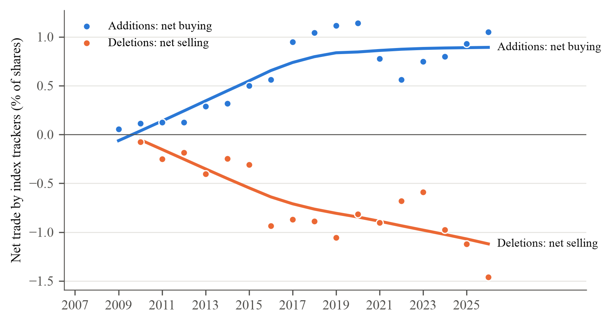
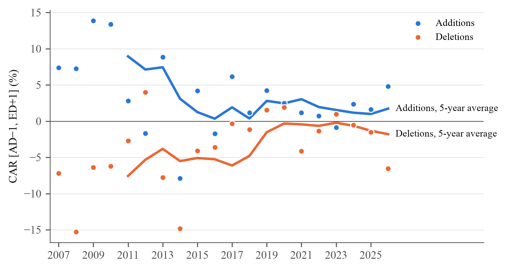
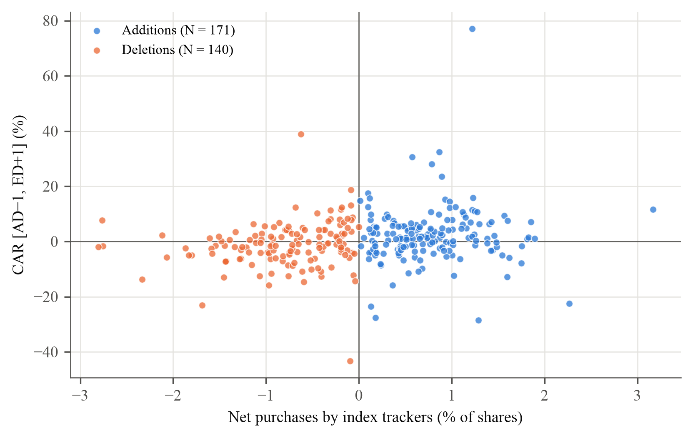
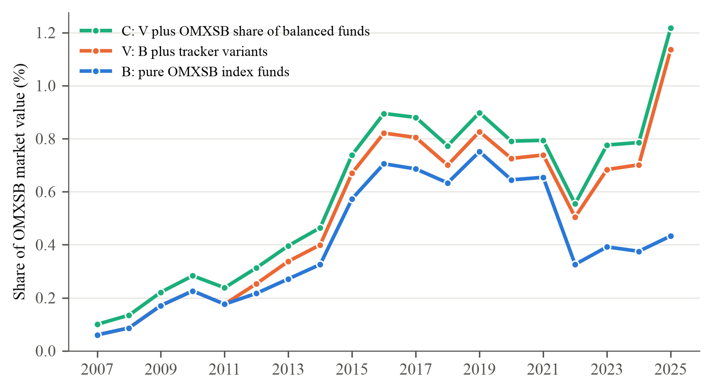

# output.v1: resultat från körningen 9 november 2026

Ögonblicksbild av `results/` från `run_all.py` (16 av 16 indatafiler stämmer, **0 FEL**). Uppdateras inte automatiskt.

## Läs här

**[Alla tabeller och figurer som PDF](tables/all_tables.pdf)**: öppnas direkt på GitHub, 13 sidor i Greenwood och Sammons ordning.
Samma innehåll i Word: [`tables/all_tables.docx`](tables/all_tables.docx), och varje tabell som egen `.docx` i [`tables/`](tables/) att klistra in i uppsatsen.

| Fil | Innehåll | Greenwood och Sammon (2025) |
|---|---|---|
| [Figur 1](tables/01_figure1_net_buying.png) | Indexfondernas nettoköp och nettoförsäljning per år | Figure 1 |
| Tabell 1, `02_table1_effect_by_year.docx` | Överavkastning år för år, med periodrader | Table I |
| Tabell 2, `03_table2_effect_by_period.docx` | Per femårsperiod och decennium, med 95 % intervall | Table I |
| [Figur 2](tables/04_figure2_effect_by_year.png) | Indexeffekten per år | Figure 2 |
| [Figur 3](tables/05_figure3_demand_vs_effect.png) | Nettoköp mot indexeffekt, en punkt per händelse | Figure 3 |
| [Figur 4](tables/06_figure4_tracker_ownership.png) | Indexfondernas andel av OMXSB | Figure 5 |
| Tabell 3, `07_table3_multiplier.docx` | Multiplikatorn M = CAR / D per period | Table V |
| Tabell 4, `08_table4_multiplier_controls.docx` | M med och utan kontroller | Table VI |
| Tabell 5, `09_table5_who_buys.docx` | Vem som köper och säljer, per fondgrupp | Table VII |
| Tabell 6, `10_table6_msci_overlap.docx` | Med och utan händelser som sammanfaller med MSCI Sweden | jfr Table VIII |
| Tabell A2, `11_tableA2_mde.docx` | Minsta påvisbara effekt | – |
| Tabell A3, `12_tableA3_fi_check.docx` | M med Finansinspektionens fonddata | – |

Varje tabells not anger inferensen: wild cluster bootstrap (intervall genom testinversion), parvis klusterbootstrap för M eller analytiska CR1-intervall.

## Figurer

## Övriga mappar

- [`effect/TABELL1.md`](effect/TABELL1.md): effekttabellen som läsbar text, med både bootstrapintervall och analytiska intervall.
- `effect/`, `fund_demand/`, `msci_overlap/`, `mde/`, `fi_check/`: alla siffror som CSV. Kolumnen `ci_metod` säger hur varje intervall är framtaget.
- `logs/`: hela utskriften från varje steg. [`check.txt`](check.txt): kontrollen av huvudsiffrorna.

Koden finns i `thesis_final/code/` (analys) och `thesis_final/code/output/` (en fil per tabell och figur).
