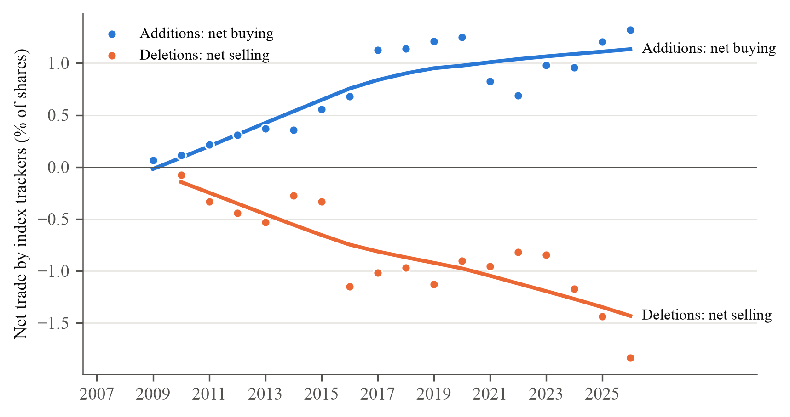
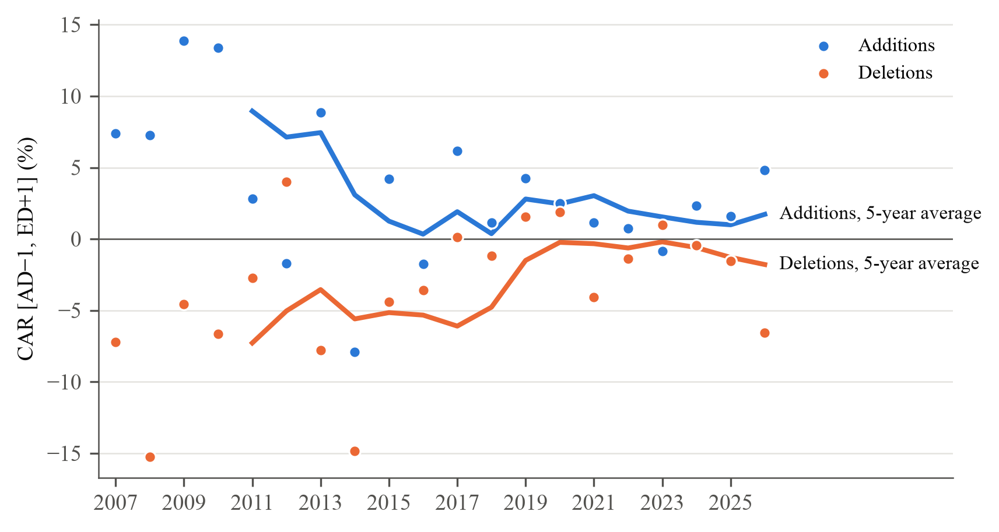
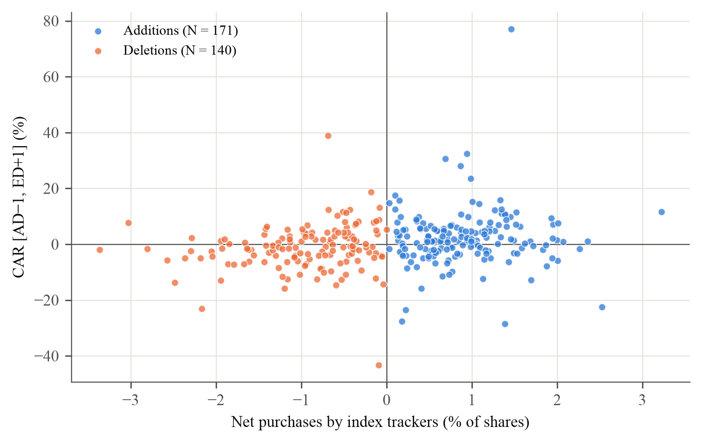
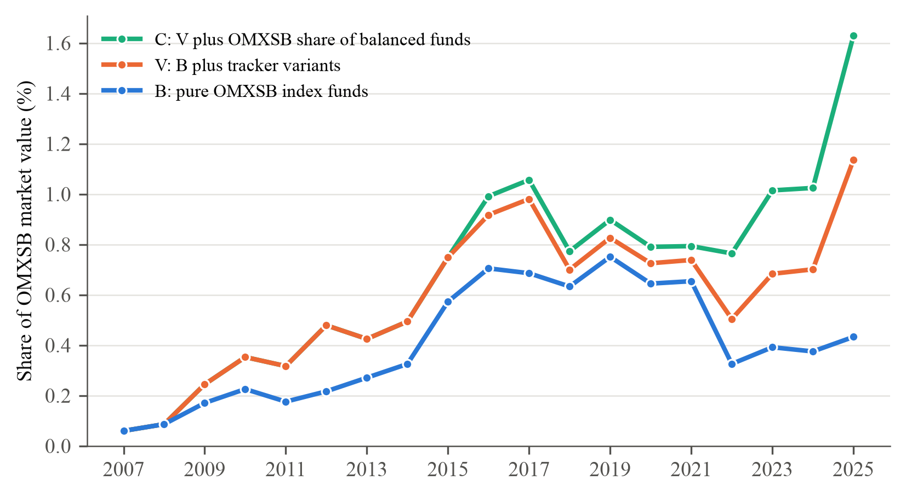
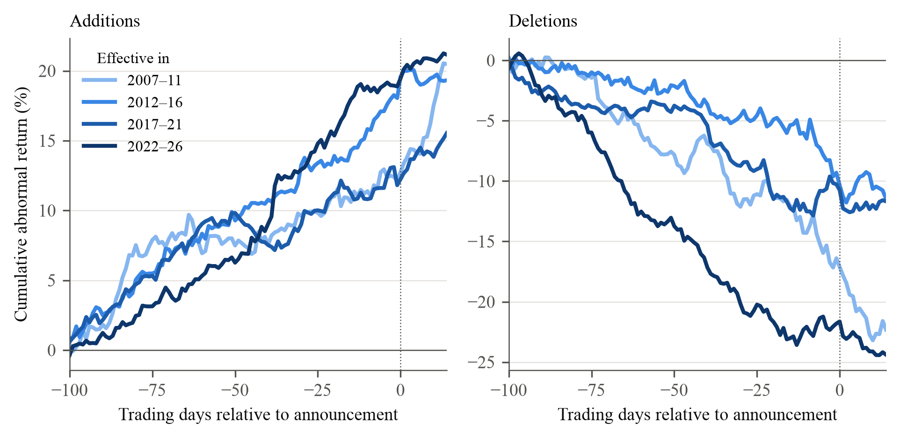
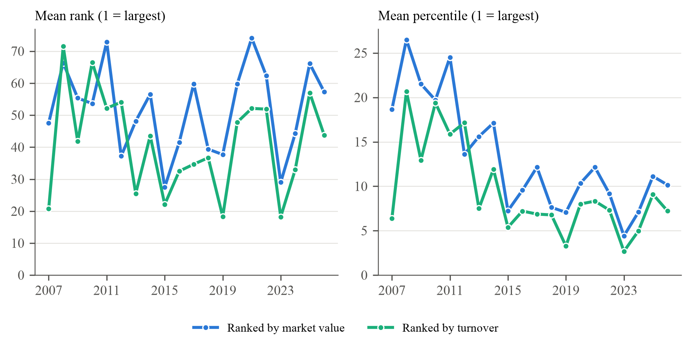
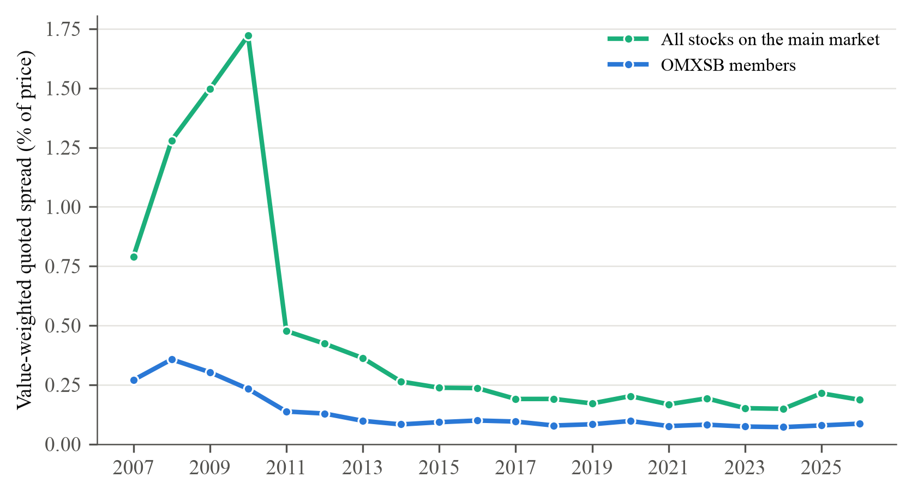
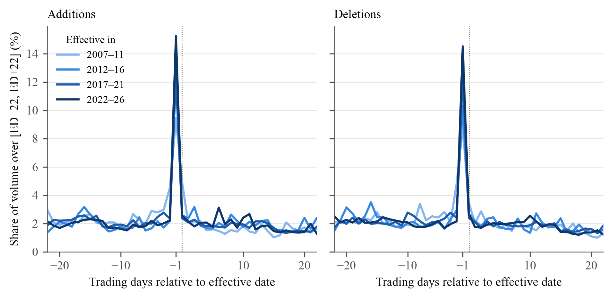

# results: alla tabeller och figurer i Greenwood och Sammon, plus robustheten

Skrivs om av `run_all.py` vid varje körning (allt utom den här filen). Committa bara efter en körning som slutar med **0 FEL** ([`check.txt`](check.txt)). Den här versionen är körningen 11 november 2026; äldre versioner finns i git-historiken (taggen `v3` = körningen 10 november).

Jämfört med körningen 9 november (tidigare `output.v1`): urvalsregeln för borttag (10 borttag utesluts enligt G&S, se `declarations/`), nyhetsgenomgången som robusthet, och nya tabeller och figurer för G&S tabell II, IV och VIII, figur 7, 8 och 9, volymen kring ändringsdagen och nyemissionerna. Från 11 november också nästan tillagda, återgången, tvillingarna och extremvärdena (steg 13–16). Noterna till de nya tabellerna och figurerna är utkast: författarna formulerar om texten.

11 november 2026, senare: fondlistan följer G&S regel (en fond räknas om innehaven visar minst hälften av indexaffärerna, se `results/fund_demand/indexaffarer_fond_ar.csv`), och huvudmåttet för indexfondernas köp är nu C (B + V + blandfondernas OMXSB-del) i M, tabellerna, figurerna och ägarandelen. B och V står bredvid (tabell 5 panel C, tabell 7, figur 4). Nyemissionstestet (tabell 8) använder splitjusterat aktieantal; raden utan justering står kvar som jämförelse.

## Läs här

**[Alla tabeller och figurer som PDF](tables/all_tables.pdf)**: öppnas direkt på GitHub, i Greenwood och Sammons ordning.
Samma innehåll i Word: [`tables/all_tables.docx`](tables/all_tables.docx), och varje tabell som egen `.docx` i [`tables/`](tables/) att klistra in i uppsatsen.

| Fil | Innehåll | Greenwood och Sammon (2025) |
|---|---|---|
| [Figur 1](tables/01_figure1_net_buying.png) | Indexfondernas nettoköp och nettoförsäljning per år | Figure 1 |
| Tabell 1, `02_table1_effect_by_year.docx` | Överavkastning år för år, med periodrader | Table I |
| Tabell 2, `03_table2_effect_by_period.docx` | Per femårsperiod och decennium, med 95 % intervall | Table I |
| [Figur 2](tables/04_figure2_effect_by_year.png) | Indexeffekten per år | Figure 2 |
| [Figur 3](tables/05_figure3_demand_vs_effect.png) | Nettoköp mot indexeffekt, en punkt per händelse | Figure 3 |
| Tabell 3, `06_table3_car_controls.docx` **ny** | CAR per period utan och med kontroller | Table II |
| [Figur 4](tables/07_figure4_tracker_ownership.png) | Indexfondernas andel av OMXSB | Figure 5 |
| [Figur 5](tables/08_figure5_price_path.png) **ny** | Kursbanan AD−100 till AD+14 per period | Figure 7 |
| Tabell 4, `09_table4_runup.docx` **ny** | Uppgången före beskedet | Table IV |
| [Figur 6](tables/10_figure6_size_rank.png) **ny** | Tilläggens storleksrang per år | Figure 8 |
| Tabell 5, `11_table5_multiplier.docx` | Multiplikatorn M = CAR / D per period | Table V |
| Tabell 6, `12_table6_multiplier_controls.docx` | M med och utan kontroller | Table VI |
| [Figur 7](tables/13_figure7_spread.png) **ny** | Spread per år | Figure 9 |
| [Figur 8](tables/14_figure8_volume.png) **ny** | Volymen kring ändringsdagen | avsnitt II.D |
| Tabell 7, `15_table7_who_buys.docx` | Vem som köper och säljer, per fondgrupp | Table VII |
| Tabell 8, `16_table8_issuance.docx` **ny** | Nyemissioner, tillägg mot nästan tillagda | avsnitt II.D |
| Tabell 9, `17_table9_omxs30.docx` **ny** | OMXS30 mot OMXSB | Table VIII |
| Tabell 10, `18_table10_msci_overlap.docx` | Med och utan händelser som sammanfaller med MSCI Sweden | jfr Table VIII |
| Tabell 11, `19_table11_near_additions.docx` **ny** | Tillägg och borttag mot nästan tillagda | – |
| Tabell 12, `20_table12_reversal.docx` **ny** | Uppgång före och återgång efter ändringen | – |
| Tabell 13, `21_table13_twins.docx` **ny** | Tvillingar: indexslaget mot systerslaget | – |
| Tabell A2, `22_tableA2_mde.docx` | Minsta påvisbara effekt | – |
| Tabell A3, `23_tableA3_fi_check.docx` | M med Finansinspektionens fonddata | – |
| Tabell A4, `24_tableA4_news_screen.docx` **ny** | Robusthet: utan egen bolagsnyhet, och alla borttag | – |
| Tabell A5, `25_tableA5_extreme_values.docx` **ny** | Robusthet: winsoriserat, utan \|CAR\| > 20, utan Sivers, median, M utan nyhetshändelserna | – |

Varje tabells not anger inferensen: wild cluster bootstrap (intervall genom testinversion), parvis klusterbootstrap för M eller analytiska CR1-intervall. Inga nya test: tabellerna och figurerna formaterar bara siffror som steg 01–12 redan räknat, och varje fil kontrollerar dem mot källfilen.

## Figurer

## Övriga mappar

- [`effect/TABELL1.md`](effect/TABELL1.md): effekttabellen som läsbar text, med både bootstrapintervall och analytiska intervall.
- [`news_screen/REASONS.md`](news_screen/REASONS.md): bedömningen av varje händelse i nyhetsgenomgången, med källa.
- `effect/`, `fund_demand/`, `msci_overlap/`, `mde/`, `fi_check/`, `controls/`, `composition/`, `liquidity/`, `other_tests/`, `news_screen/`, `extreme_values/`, `near_additions/`, `reversal/`, `twins/`: alla siffror som CSV. Kolumnen `ci_metod` säger hur varje intervall är framtaget.
- `logs/`: hela utskriften från varje steg. [`check.txt`](check.txt): kontrollen av huvudsiffrorna.

Koden finns i `thesis_final/code/` (analys) och `thesis_final/code/output/` (en fil per tabell och figur).
